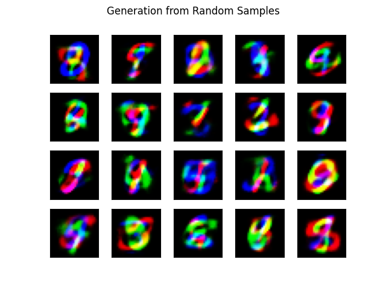
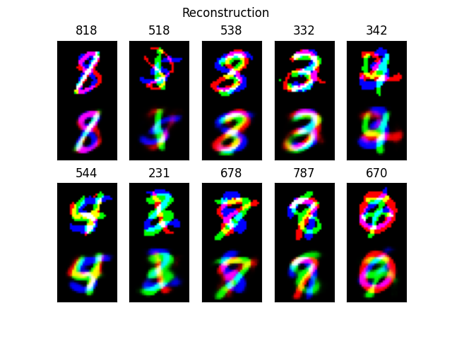
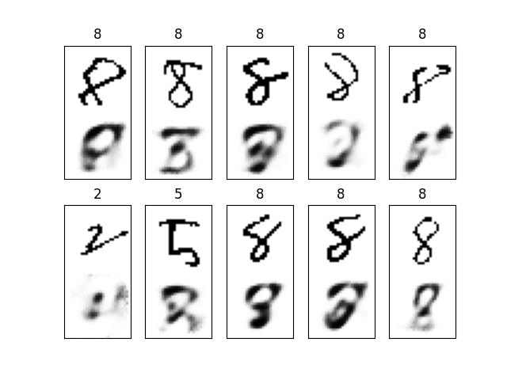

# Description

An autoencoder and a variational autoencoder (VAE) implemented in TensorFlow/Keras and tested on MNIST and "stacked" MNIST. Stacked MNIST is a 3-channel color version of MNIST with one digit per channel.

Both models are evaluated on three tasks:
- **Reconstruction**: encode and decode test images
- **Generation**: decode random samples from the latent space
- **Anomaly detection**: train with one class (the digit 8) removed, then show the test images with the highest reconstruction loss

A pretrained CNN classifier (`verification_net.py`) scores reconstructed and generated images by class coverage and predictability. `stacked_mnist.py` provides the datasets in mono/color, binary/float and complete/missing-class modes.

# Usage
```sh
pip install tensorflow numpy matplotlib
python3 autoencoder.py
python3 variational_autoencoder.py
```
Trained weights for all models are included in `models/`. The data mode and model file are set in each script's `__main__` block.

# Example outputs



